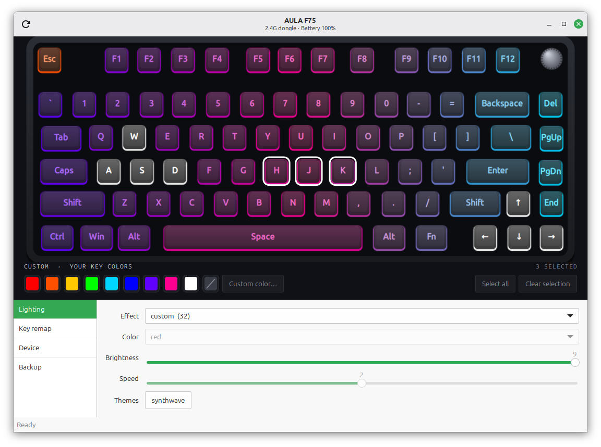
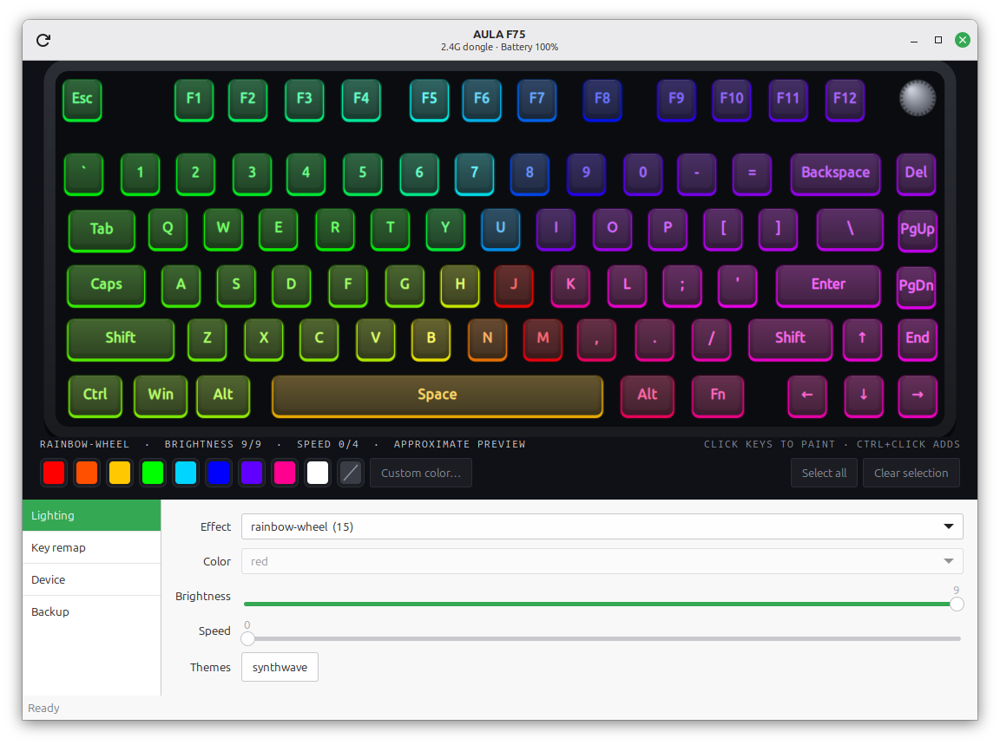
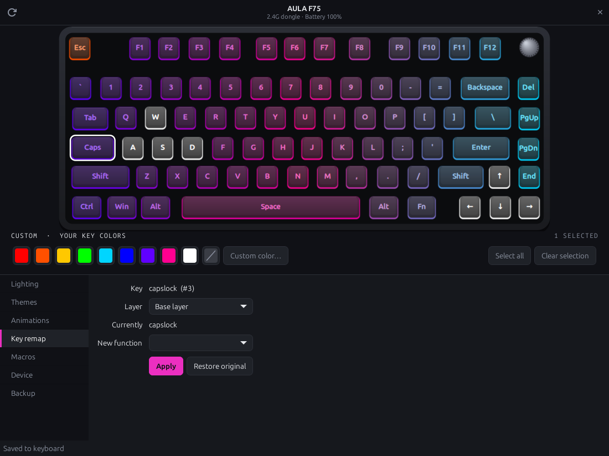

<div align="center">

# aula-f75-hub

**Lighting, per-key RGB and key remapping for the AULA F75 keyboard. On Linux, without the vendor software.**

**English** · [Türkçe](README.tr.md)

[](https://github.com/bakiakyol/aula-f75-hub/actions/workflows/tests.yml)




</div>

The official AULA software only runs on Windows, and on the machine it was tried on,
its lighting settings did not even work there. This project talks to the keyboard
directly over its HID configuration channel. The protocol was worked out by reading
the official app's code (without running it) and checking every finding on a real
keyboard.

## Features

- **15 lighting effects** with color, brightness and speed: breathing, raindrops,
  snake, waterfall, rainbow wheel, reactive ripples…
- **Per-key RGB**: click keys on the drawing and paint them. Includes ready-made themes.
- **Key remapping** on the base and Fn layers, each change read back and verified.
- **Macros**: key combos, typed text and delays, run once, N times, while held or
  until another key is pressed.
- **Device settings**: side light, knob mode (volume or lighting), OS mode
  (Windows / Android / Mac), Windows key lock.
- **Battery level** (experimental) and connection type in the header.
- **Backup and restore**, including the keyboard's factory settings.
- **Animated previews** that show roughly what the running effect looks like.
- A full **command-line tool** for scripting, plus a GTK 3 interface.
- No dependencies beyond Python. The GUI uses GTK 3, which ships with most desktops.

<table>
<tr>
<td></td>
<td></td>
</tr>
<tr>
<td align="center">Animated effect preview</td>
<td align="center">Key remapping</td>
</tr>
</table>

## Supported hardware

The connection type is chosen with the switch on the back of the keyboard
(2.4G / wired / Bluetooth). The tool finds whichever one is active.

| Keyboard | Connection | Status |
|---|---|---|
| AULA F75 | 2.4G dongle (`3554:fa09`) | ✅ Verified |
| AULA F75 | Bluetooth (`3554:fa07`) | ✅ Verified |
| AULA F75 | Cable (`258a:010c`) | ❌ Not supported yet (different transport) |
| Other AULA models | – | ❓ Unknown. Please [report](../../issues/new/choose) |

## Installation

```bash
git clone https://github.com/bakiakyol/aula-f75-hub.git
cd aula-f75-hub
./install.sh
```

`install.sh` installs a udev rule so the keyboard can be used without `sudo`, puts an
`aula` command in `~/.local/bin` and adds **AULA F75** to the application menu.
`./install.sh --remove` undoes all of it.

The GUI needs GTK 3 for Python, which Linux Mint and Ubuntu already include. On other
distributions install `python3-gi` and `gir1.2-gtk-3.0` (or your distro's equivalent).
The command-line tool needs nothing but Python 3.10+.

## Usage

### Graphical interface

```bash
aula gui
```

Click a key to select it (**Ctrl+click** adds more), then pick a color below the
board. The pages on the left change the effect, remap keys, adjust the side light,
knob and OS mode, and make backups.

### Command line

```bash
aula info                                  # effect, brightness, battery, side light, knob…
aula effects                               # list effects and colors
aula effect breathing -c blue -b 9 -s 2    # -c color, -b brightness 0-9, -s speed 0-4
aula key-color --clear all=0010ff w=ff0000 a=ff0000 s=ff0000 d=ff0000
aula preset synthwave                      # built-in per-key theme
aula remap capslock lctrl                  # undo: aula remap capslock capslock
aula remap f1 esc -l 1                     # remap on the Fn layer
aula macro set hello "text:hello" --key y -l 1          # Fn+Y types "hello"
aula macro set paste "ctrl+c" "wait:100" "ctrl+v" --key f1 --repeat 2
aula macro list                            # stored macros and their keys
aula macro delete hello                    # its key gets its factory function back
aula side-light breathing                  # off | fill | breathing | static
aula knob lighting                         # media | lighting
aula os mac                                # windows | android | mac
aula win-lock on
aula backup ~/aula-backup
aula restore ~/aula-backup
```

On a Turkish Q layout the letters `ğ ü ş ö ç ı` work as key names too. Macro
`text:` steps send US-layout key positions, so stick to letters that sit in the same
place on your layout.

### Lighting effects

| # | Effect | # | Effect |
|---|---|---|---|
| 1 | static | 10 | snake |
| 2 | breathing | 11 | stream |
| 3 | spectrum | 12 | reactive (pressed key lights up) |
| 4 | ripple-row | 13 | center-wave |
| 5 | raindrops | 15 | rainbow-wheel |
| 6 | wave | 16 | waterfall |
| 7 | ripple | 17 | center-flash |
| 8 | twinkle | 32 | custom (per-key colors) |

The official app's effect names and numbers don't match the firmware, so this list
was made by trying every effect number on the keyboard.

## Safety

- `backup/` holds the factory settings of a stock F75, read before this tool ever
  wrote to it. `aula restore backup` puts them on your keyboard.
- Holding **Fn + Esc** factory-resets the keyboard.
- The tool only sends configuration commands it understands. It never touches the
  firmware or the bootloader.

## Troubleshooting

| Message | Fix |
|---|---|
| `permission denied` | Run `./install.sh`, or install the udev rule from `udev/` by hand |
| `the keyboard didn't answer` | The keyboard is asleep. Press any key and try again |
| `a key seems to be held down` | Let go of the keyboard. The tool waits for all keys to be released before it talks to the keyboard; otherwise a dropped key-release can make a key repeat forever |
| `connected by cable` | Use the 2.4G dongle or Bluetooth; wired mode isn't supported yet |

## How it works

The keyboard listens on a vendor HID channel (report `0x13`, 20-byte packets with an
8-bit checksum) and acknowledges every write by echoing it back. Settings live in a
handful of blocks: a 128-byte lighting block, a 504-byte keymap per layer, and a
378-byte per-key color table. The full write-up is in
[docs/protocol.md](docs/protocol.md).

## Roadmap

- [ ] Wired mode (same data, different transport)
- [x] Bluetooth
- [x] Macros
- [ ] Recording macros from the keyboard in the GUI
- [ ] More themes

## Contributing

Bug reports and device reports are very welcome. See [CONTRIBUTING.md](CONTRIBUTING.md).

## Disclaimer

This is an independent project. It is not affiliated with, endorsed by, or supported
by AULA. "AULA" is used only to name the hardware it works with. Use at your own risk.

## License

[MIT](LICENSE) © 2026 Baki Akyol
